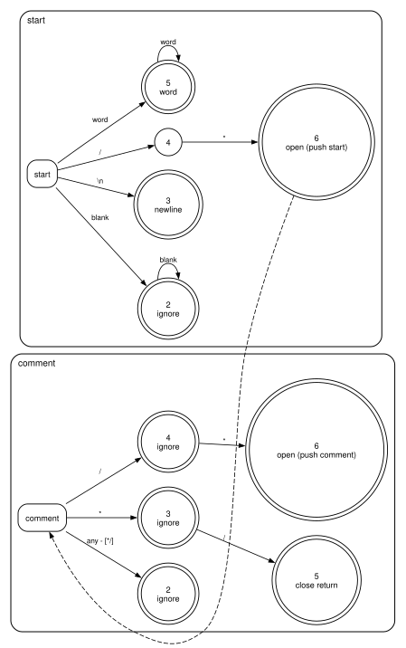
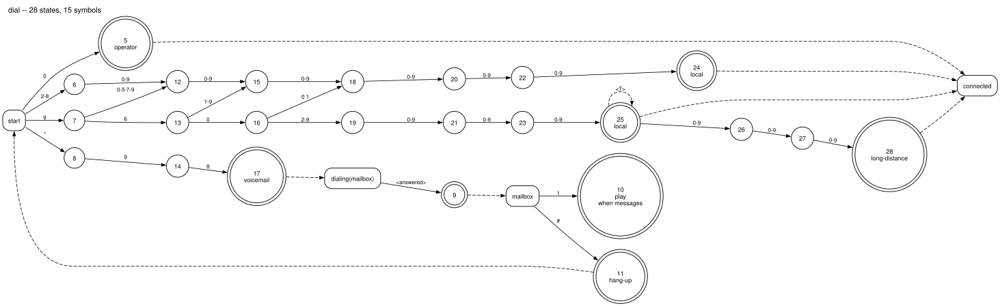
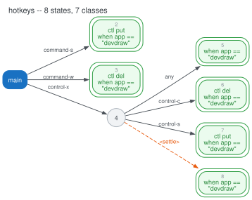

# automaton

Small languages for lexers, dial plans and keyboard shortcuts, compiled to
tables you can run, check and draw.

Each language is checked for conflicts when it compiles, so a rule that can
never fire, or two rules on the same input, is an error rather than a
surprise. The runtimes use only the standard library.

```sh
go install github.com/cptaffe/automaton/cmd/...@latest
```

## Packages

| Package | |
|---|---|
| [`fa`](fa) | Finite automata over any integer symbol: sets, expressions, NFA → DFA, minimisation |
| [`lex`](lex) | The runtime generated lexers use |
| [`lex/gen`](lex/gen) | The `.lex` language, compiled to lexer tables |
| [`seq`](seq) | Key-sequence grammars, compiled to tables, and a machine to run them |
| [`seq/keypad`](seq/keypad) | Dial plans for a payphone keypad |
| [`seq/hotkey`](seq/hotkey) | Keyboard shortcuts that run rc scripts |
| [`lr`](lr) | The grammar in goyacc's `y.output`, and its machine over tokens |
| [`dot`](dot) | Graphviz drawings; `lex/draw`, `seq/draw` and `lr/draw` adapt to it |
| [`cmd/genlex`](cmd/genlex) | `.lex` → Go tables and drawings |
| [`cmd/genseq`](cmd/genseq) | Dial plans and shortcuts → drawings |
| [`cmd/lrdot`](cmd/lrdot) | `y.output` → drawings |

## Lexers

A `.lex` file is a set of scopes. Each rule reads the longest input it can,
then emits a token, ignores the input, or moves to another scope. A scope with
a parameter returns to wherever it was entered from, so comments can nest:

```
start {
  "/*"    emit open  -> comment(this)
  word+   emit word
  blank+  ignore
  "\n"    emit newline
}

comment(then) {
  "/*"    emit open  -> comment(this)
  "*/"    emit close -> then
  any     ignore
}
```

The lexer runs in its own goroutine and sends tokens on a channel. The
channel closes at the end of the input, and an error is the last token sent.
While only rules that ignore their input can still match, the text read so far
is let go, so memory is bounded by the longest token, not the longest comment:

```go
//go:generate go run github.com/cptaffe/automaton/cmd/genlex -go scan.gen.go -package scan comments.lex

toks, err := lex.Lex(ctx, scan.Spec, r, "start")
if err != nil {
	return err
}
for tok := range toks {
	if tok.Err != nil {
		return tok.Err
	}
	fmt.Println(scan.Spec.Token(tok.Kind), tok.Text)
}
return nil
```



## Key sequences

Both dialects compile to the same kind of table:

- A machine starts in the first scope, and after each match returns to the
  start of the scope it is in.
- `-> scope` after a rule moves to that scope.
- `-> scope` on a line of its own reads that scope's rules in, and
  `-> scope when ...` does so only while the condition holds. A key is taken
  only when a rule that holds can use it.
- A delay declared with `%delay` is a symbol in its own right: it arrives when
  the machine has waited that long. A rule that would otherwise be the start
  of a longer one ends with it, as `NXX-XXXX T` does; without it the pair is a
  conflict.
- `any` reads a key no other rule names at that point, and `... any` is a
  scope's default.
- A scope can take a parameter, `dialing(then)`, and `this` names the scope a
  rule is in.

### Keypad

`N` is 2–9 and `X` is 0–9. As in an MGCP digit map, `T` is the timer: seven
digits dial a local call once nothing follows them for five seconds, or at once
on `#`. `dialing(then)` waits for the call to be answered, and `connected`,
with no rules, ends the plan:

```
%delay T 5s
%delay abandon 16s

start:
  0 T           do operator         -> connected
  0 NXX-XXXX    do collect          -> connected
  *98           do voicemail        -> dialing(mailbox)
  NXX-XXXX T    do local            -> connected
  NXX-XXXX #    do local            -> connected
  960-NXX-XXXX  do long-distance    -> connected
  ... abandon   do dial-again

dialing(then):
  answered      -> then

connected:

mailbox:
  1             do play       when messages
  #             do hang-up    -> start
```

```go
plan, err := keypad.Parse(f, "dial.tree")
if err != nil {
	return err
}
t, err := keypad.Compile(plan)
if err != nil {
	return err
}
m, err := seq.NewMachine(t, "")
if err != nil {
	return err
}
star, _ := t.Alpha.Of("*")
taken, fired := m.Step(star, seq.Env{"messages": "1"})
```

Several plans compile together with `keypad.Compile`, and a `->` to another
plan's name goes to its first scope.



### Hotkeys

Shortcuts run rc scripts that share a prelude. `main` reads in `acme`'s rules
only while Acme has the keyboard. `control-x` shows the window once a second
passes with nothing after it, or at once when another key comes; `peek` lets
that key go on to do what it would have. `group` is a mode that `escape`
leaves:

```
%{
fn ctl { echo $1 | 9p write acme/`{9p read acme-focused/focus}/ctl }
%}
%delay settle 1s

main:
	-> acme when app == "devdraw"

acme:
	command-s		{ ctl put }	# save
	command-w		{ ctl del }	# close
	control-x control-s	{ ctl put }	# save, the emacs way
	control-x settle	{ ctl show }	# show, once nothing follows
	control-x peek any	{ ctl show }	# or at once, and the key goes on
	command-g		{ ctl nomark } -> group

group:
	-> acme
	escape			{ ctl mark } -> main	# one undo takes the group back
```

A key no rule takes passes through. An empty block, as in `control-c any { }`,
takes a key and does nothing, and `... any { }` in a scope keeps every key
from the application while the scope is current.

```go
r, err := hotkey.Parse(f, "hotkeys", hotkey.US)
if err != nil {
	return err
}
m, err := seq.NewMachine(r.Table, "")
if err != nil {
	return err
}
key, _ := r.Table.Alpha.Of("control-x")
taken, fired := m.Step(key, seq.Env{"app": "devdraw"})
for _, a := range fired {
	exec.Command("rc", "-c", r.Prelude+"\n"+a.Action).Start()
}
```

The alphabet is every chord a `Keyboard` can make, so every key the keyboard
sends has a symbol. `m.Waits()` names the delays to start a timer for. When one
runs out, step the machine with it.



## LR automata

`lrdot` reads the report goyacc writes with `-v`, and draws the grammar and
the machine over its tokens. It notes when the grammar nests too deeply for a
machine to read it exactly:

```sh
goyacc -o /dev/null -v y.output gram.y
lrdot -name gram y.output gram.dot
```

The drawings are made by [`docs/draw.sh`](docs/draw.sh) from
[`examples`](examples).
